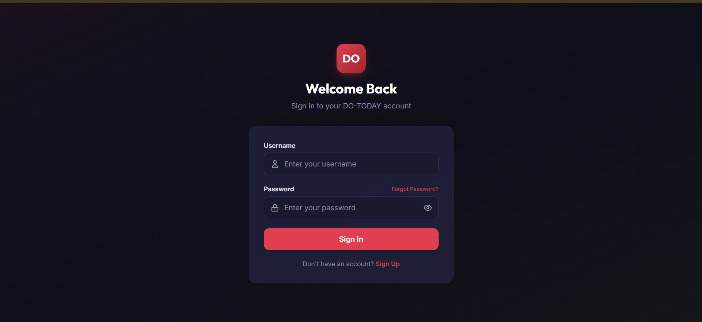
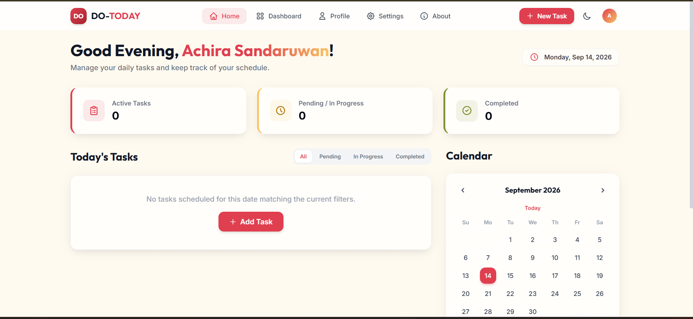
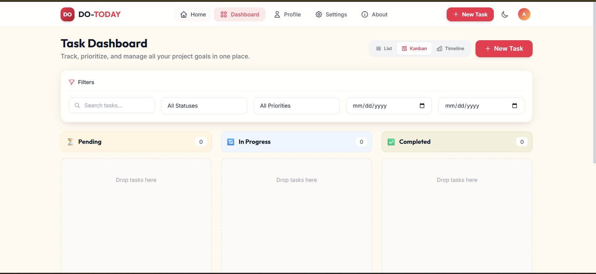

# DO-TODAY — Product & Engineering Specification

> **Audience:** AI coding agents (and humans) recreating the project from scratch in a fresh repository.
> **Goal:** Rebuild **DO-TODAY**, a full-stack personal task manager, with a UI that is **visually identical to the reference screenshots** in `docs/screenshots/`, and deploy it to production.

---

## 0. Ground Rules for the Agent (read first)

1. **The screenshots are the source of truth for UI.** Do not redesign, re-theme, re-copy, re-space, or "improve" anything visible in them. Labels, icons, ordering, colors, spacing, and copy must match.
2. Where a screen is **not** shown in the screenshots (Profile, Settings, About, List view, Timeline view, task modal, Sign Up, Forgot Password, dark mode), design it to be **consistent** with the visible design language in §4, and keep it minimal.
3. Build in the phases of §13. Finish and verify each phase before the next.
4. Never commit secrets. Use `.env` files and commit only `.env.example`.
5. The repository is brand new. Initialize git, commit in small logical steps with clear messages.
6. If a requirement here conflicts with a screenshot, **the screenshot wins**.

---

## 1. Project Overview

DO-TODAY is a clean, responsive personal task manager.

**Key features**

| # | Feature | Notes |
|---|---------|-------|
| 1 | Multi-view dashboard | **List**, **Kanban**, **Timeline (Gantt-style)** views, toggled from a segmented control |
| 2 | Drag & drop Kanban | Move tasks Pending → In Progress → Completed (and back) using `@hello-pangea/dnd` |
| 3 | Secure authentication | JWT login/signup, bcrypt hashing, security-question flow for password recovery |
| 4 | Attachments | Attach PDFs / images to tasks |
| 5 | Data export | One-click JSON backup of the user's data |
| 6 | Light / Dark mode | Toggle in navbar; persisted |
| 7 | Home page | Greeting, stats cards, today's tasks with status tabs, month calendar |
| 8 | Filters | Search, status, priority, date range |

---

## 2. Tech Stack (fixed — do not substitute)

**Frontend**
- React **19** + Vite (latest stable; originally "Vite 8")
- Tailwind CSS **v3** (not v4)
- React Router **v7**
- `@hello-pangea/dnd` (drag & drop)
- Axios
- Context API for state (AuthContext, ThemeContext, TaskContext)
- Icon set: **lucide-react** (the line icons in the screenshots match Lucide: `home`, `layout-grid`, `user`, `settings`, `info`, `plus`, `moon`/`sun`, `filter`, `search`, `list`, `kanban`/`layout-dashboard`, `bar-chart-horizontal`, `clipboard-list`, `clock`, `circle-check`, `lock`, `eye`/`eye-off`, `chevron-left/right`, `calendar`)
- Fonts (Google Fonts): **Outfit** for headings/logo/numbers, **Inter** for body/UI. (Headings in the screenshots are a geometric sans matching Outfit.)

**Backend**
- Node.js (LTS), Express.js, MongoDB, Mongoose
- `jsonwebtoken`, `bcryptjs`, `morgan`, `cors`, `dotenv`, `multer`, `express-validator` (or `zod`), `helmet`, `express-rate-limit`
- Dev: `nodemon`

**Architecture:** modular **MVC** — `controllers/`, `routes/`, `models/`, `middleware/`, `config/`, `utils/`. RESTful API with **route-level JWT middleware**. MongoDB **indexes** for user-scoped queries. Robust **CORS** allow-list.

---

## 3. Repository Structure (monorepo)

```
DO-TODAY/
├── README.md
├── DO-TODAY_SPEC.md              # this file
├── docs/
│   └── screenshots/              # reference images (source of truth)
├── client/
│   ├── index.html
│   ├── package.json
│   ├── vite.config.js
│   ├── tailwind.config.js
│   ├── postcss.config.js
│   ├── .env.example              # VITE_API_URL=
│   └── src/
│       ├── main.jsx
│       ├── App.jsx
│       ├── index.css             # tailwind layers + CSS variables
│       ├── api/axios.js          # axios instance + auth interceptor
│       ├── context/              # AuthContext, ThemeContext, TaskContext
│       ├── components/
│       │   ├── layout/           # Navbar, ProtectedRoute, PageShell
│       │   ├── tasks/            # TaskCard, TaskModal, FilterBar, ViewSwitcher
│       │   ├── kanban/           # KanbanBoard, KanbanColumn
│       │   ├── list/             # TaskList
│       │   ├── timeline/         # TimelineView
│       │   ├── home/             # StatCard, TodayTasks, MiniCalendar
│       │   └── ui/               # Button, Input, Badge, Modal, Toast
│       ├── pages/                # Login, Signup, ForgotPassword, Home, Dashboard, Profile, Settings, About
│       └── utils/                # date helpers, greeting helper
└── server/
    ├── package.json
    ├── .env.example
    ├── server.js
    └── src/
        ├── config/db.js
        ├── models/               # User.js, Task.js
        ├── controllers/          # auth, task, user, export
        ├── routes/               # auth.routes, task.routes, user.routes
        ├── middleware/           # auth.js, error.js, upload.js, validate.js
        └── utils/
```

---

## 4. Design System (derived from screenshots)

> Values below are visual estimates from the screenshots. Define them once as CSS variables / Tailwind theme tokens, then **compare against the screenshots side-by-side** and adjust until indistinguishable.

### 4.1 Color tokens

| Token | Approx. value | Usage |
|-------|---------------|-------|
| `primary` | `#E23E52` (crimson/red) | Buttons, active nav text, links, selected calendar day, "TODAY" in logo |
| `primary-gradient` | `#E23E52 → #B8283D` (top-left → bottom-right) | The "DO" logo tile |
| `primary-soft` | `#FCE8EB` | Active nav pill bg, "Active Tasks" icon tile bg |
| `page-bg-light` | `#FFF9EC` (warm cream) | Light-mode app background |
| `surface-light` | `#FFFDF8` (near-white warm) | Cards on light mode |
| `navbar-bg-light` | `#FFFFFF` | Light navbar |
| `text-strong` | `#111827` | Headings |
| `text-muted` | `#6B7280` | Subtitles, secondary labels |
| `border-light` | `#EDE9DF` / `#E5E7EB` | Card & input borders |
| `pending-bg` | `#FFF3DD` (soft amber) | Pending column header, border `#F6E3BE` |
| `progress-bg` | `#EAF2FF` (soft blue) | In Progress header, border `#CFE0FA` |
| `completed-bg` | `#EFEEDC` (soft olive) | Completed header, border `#DAD8B8` |
| `stat-red` | `#E23E52` | Left border, "Active Tasks" |
| `stat-amber` | `#F5C46B` border / `#B7791F` icon | "Pending / In Progress" |
| `stat-olive` | `#8A9A2B` | "Completed" |
| `login-bg` | vertical dark gradient `#1A1020` (top, faint maroon) → `#10101A` | Login page background |
| `login-card` | `#1E1E38` | Login card |
| `login-input` | `#17172B` with 1px border `#2C2C4A` | Login inputs |
| `login-muted` | `#8E8EB0` | Login subtitle/placeholder |
| `avatar-gradient` | orange `#F59E5B` → red `#E8506A` | User avatar circle (initial letter, white, bold) |
| `greeting-gradient` | `#E23E52 → #F4A94E` (left→right) | User name in "Good Evening, **Name**!" |

### 4.2 Typography
- **Headings** (page titles, logo, section titles, stat numbers, column titles): Outfit, weight 700/600.
  - Page title ("Task Dashboard", greeting): ~36–40px, bold, `text-strong`.
  - Section title ("Today's Tasks", "Calendar"): ~28px, bold.
- **Body/UI**: Inter, 14–16px; subtitle text ~18px muted.
- **Nav items**: Inter 15–16px medium.
- **Logo**: "DO-" in dark text + "TODAY" in `primary`, Outfit bold ~26px.

### 4.3 Shape, spacing, elevation
- Cards: radius **16–20px**, soft shadow (`0 4px 20px rgba(0,0,0,0.06)`), 1px subtle border.
- Inputs/selects: radius **12px**, height ~54px (dashboard filters) / ~60px (login), 1px border.
- Buttons (primary): radius **12px**, bg `primary`, white bold text, soft red shadow.
- Pills / segmented control: container radius 12px with light gray bg `#F1F3F7`; active segment is white with `primary` text and subtle shadow.
- Page container: max-width ≈ **1520px** at 1919px viewport, with ~195px side padding on wide screens (i.e. centered container, `max-w-7xl`-ish with generous gutter). Keep the same proportions at this viewport.
- Navbar height ≈ **80px**, white, with a bottom 1px border.

---

## 5. Screen Specifications

### 5.1 Login — `/login`  
Reference: 

- **Page**: full-viewport dark vertical gradient (see `login-bg`), content centered horizontally, starting ~120px from top.
- **Logo tile**: 80×80px rounded-square (radius ~20px), red gradient, white bold **"DO"** (Outfit), subtle red glow shadow.
- **Heading**: "**Welcome Back**" — white, Outfit bold ~36px, centered.
- **Subheading**: "Sign in to your DO-TODAY account" — `login-muted`, ~20px.
- **Card**: width ~560px, radius ~24px, padding ~40px, bg `login-card`.
  - Label **Username** (white, semibold ~16px) → input with leading **user** icon, placeholder "Enter your username".
  - Label row: **Password** (left) and a red link **"Forgort Password?"** (right, ~15px)  
    > ⚠️ **Fidelity note:** the screenshot literally reads "Forgort Password?" (a typo in the original). The owner asked for *no changes to the screenshots*, so **default to reproducing it exactly**. Put the string in a single constant (`FORGOT_LABEL`) so it can be corrected with a one-line change later. Mention this in the README so the owner can decide.
  - Password input: leading **lock** icon, placeholder "Enter your password", trailing **eye** toggle (show/hide password).
  - **Sign In** button: full-width, ~60px height, `primary` bg, white bold text.
  - Footer text centered: "Don't have an account? **Sign Up**" (Sign Up is a red link → `/signup`).
- Behavior: submit calls `POST /api/auth/login`; show inline error on failure; on success store JWT and navigate to `/` (Home).

### 5.2 Home — `/`  
Reference: 

**Navbar (shared by all authenticated pages)**
- Left: logo tile (44px, "DO") + wordmark **DO-TODAY** (see §4.2).
- Center nav (pill links with icon + label): **Home**, **Dashboard**, **Profile**, **Settings**, **About**. Active item: `primary` text + `primary-soft` pill background. Icons in order: home, layout-grid, user, settings (gear), info (circle-i).
- Right: **+ New Task** button (primary, ~150×46px), **moon** icon button (theme toggle; shows sun in dark mode), and a circular **avatar** (~40px, gradient, white initial of the user's name — "A" in the screenshot).
- Hover on inactive nav item shows a light neutral pill (visible on "Home" in the Dashboard screenshot).

**Header row**
- Left: `Good {Morning|Afternoon|Evening}, ` + user's full name rendered with `greeting-gradient`, then `!`. Rules: Morning 05:00–11:59, Afternoon 12:00–16:59, Evening 17:00–04:59.
- Under it: "Manage your daily tasks and keep track of your schedule." (muted, ~19px)
- Right: date chip (white pill, red **clock** icon, bold text) formatted like **"Monday, Sep 14, 2026"** (`weekday long, month short, day numeric, year numeric`).

**Stat cards (3 in a row, equal width, ~130px tall)**
Each: white-ish card, radius ~20px, **4px colored left border** (rounded), icon tile (60×60, radius 14px, tinted bg) at left, label (muted ~17px) above a big bold number (~32px).
| Card | Left border | Icon (Lucide) | Tile tint | Value |
|------|-------------|---------------|-----------|-------|
| Active Tasks | red | `clipboard-list` (red) | `primary-soft` | tasks not completed *(see note)* |
| Pending / In Progress | amber | `clock` (amber/brown) | `#FDF6E7` | count of pending + in-progress |
| Completed | olive-green | `circle-check` (olive) | `#EEF0E2` | count of completed |

> Note: "Active Tasks" = tasks whose status is not `completed` (all dates). Define this once in a utility and unit-test it. Counts are user-scoped.

**Two-column area** (left ≈ 2/3, right ≈ 1/3, gap ≈ 40px)
- **Left — "Today's Tasks"** (section title) with a **segmented tab control** on the right: `All` (default, active = white + red text), `Pending`, `In Progress`, `Completed`.
  - Body is a card with a **dotted/dashed very light border**. Empty state text (centered, muted): "**No tasks scheduled for this date matching the current filters.**" followed by a primary button "**+ Add Task**" (opens the New Task modal, pre-filled with the selected calendar date).
  - When tasks exist: list of `TaskCard`s for the **selected date** (defaults to today), filtered by tab.
- **Right — "Calendar"** (section title) + white card:
  - Header: `‹` prev, "**September 2026**" (bold), `›` next.
  - Small red "**Today**" label centered under the header (it jumps back to the current month/date when clicked).
  - Weekday row: `Su Mo Tu We Th Fr Sa` (muted, small, semibold).
  - Day grid: 7 columns; current month days only (leading blanks before the 1st). **Today** is a solid `primary` rounded-square (radius ~12px, ~46px) with white bold number. Clicking a day selects it and updates "Today's Tasks" (selected non-today day gets a `primary-soft` square). Days that have tasks show a small dot under the number.
  - The card may extend below the fold (page scrolls).

### 5.3 Dashboard — `/dashboard`  
Reference: 

**Header row**
- Title **"Task Dashboard"**; subtitle "Track, prioritize, and manage all your project goals in one place."
- Right: **view switcher** segmented control with three options, each icon + label: `List` (`list` icon), `Kanban` (kanban icon, **active in screenshot**: white bg, red text/icon), `Timeline` (bar-chart-horizontal icon). Followed by a large primary **+ New Task** button (~185×55px).
- The selected view persists (localStorage `dt_view`). Default = **Kanban**.

**Filters card** (white, radius ~20px, padding ~25px)
- Header: red **funnel** icon + "Filters" (semibold) with a thin divider underneath.
- One row of 5 equal-width controls (gap ≈ 20px, height ≈ 54px, radius 12px):
  1. Search input with leading search icon — placeholder "Search tasks…" (matches title + description, debounced 300ms)
  2. Select — default "**All Statuses**" (options: All Statuses, Pending, In Progress, Completed)
  3. Select — default "**All Priorities**" (options: All Priorities, Low, Medium, High)
  4. Date input (`mm/dd/yyyy`) — **From** (filter tasks whose due date ≥)
  5. Date input (`mm/dd/yyyy`) — **To** (filter tasks whose due date ≤)
- Filters apply to all three views.

**Kanban board** — 3 equal columns, gap ≈ 30px
- **Column header cards** (radius ~14px, height ~66px, tinted bg + border, count badge on the right as a white rounded pill with the number):
  - **Pending** — ⏳ hourglass emoji icon, amber tint
  - **In Progress** — blue 🔄 "arrows-counterclockwise" tile icon, light-blue tint
  - **Completed** — green ✅ check tile icon, olive tint
- **Droppable area** under each header: min-height ≈ 600px, radius ~14px, **dashed** 2px very light gray border, background slightly off-white (`#FBFAF7`-ish). Empty state: centered muted text "**Drop tasks here**" near the top.
- Task cards (not in screenshot — design to match): white card, radius 14px, title (semibold), 2-line description clamp, priority badge (Low=green, Medium=amber, High=red), due-date chip with calendar icon, attachment count (paperclip), and edit/delete icon buttons on hover. Dragging lifts the card with a shadow and highlights the target column.
- On drop: optimistic UI update → `PATCH /api/tasks/:id/status`; on failure, roll back and show a toast.
- Column counts update live.

**List view** — a clean table/list: checkbox-style status toggle, title, priority badge, status badge, due date, actions. Sortable by due date / priority.

**Timeline view** — Gantt-style horizontal bars on a day/week scale from `startDate` → `dueDate`, colored by status, with a "today" vertical marker; horizontally scrollable. Implement with plain CSS grid/SVG (no heavy chart lib).

### 5.4 Other pages (not in screenshots — keep minimal & on-brand)
- **Sign Up `/signup`**: same dark layout as Login. Fields: Full Name, Username, Password, Confirm Password, Security Question (select), Security Answer. Link back to Sign In.
- **Forgot Password `/forgot-password`**: 3-step flow on the dark layout: (1) enter username → (2) show their security question, enter answer → (3) set new password.
- **Profile `/profile`**: view/edit full name, username (read-only), change password; avatar preview.
- **Settings `/settings`**: theme (Light/Dark), **Export my data (JSON)** button, **Delete account** (with confirm).
- **About `/about`**: short description of DO-TODAY, features, tech stack.
- **New/Edit Task modal**: fields — Title*, Description, Status, Priority, Start date, Due date, Attachments (drag-drop zone, PDF/PNG/JPG/WebP, ≤ 5 MB each, ≤ 5 files). Validation with inline errors.
- **Dark mode** (authenticated app): page bg `#0F1117`-ish, cards `#1A1D27`, borders `#2A2E3B`, text `#E5E7EB`, keep `primary`. The login/signup pages are **always dark** (as in the screenshot).

---

## 6. Responsive Behavior
- ≥1280px: layout exactly as screenshots.
- 768–1279px: Home two-column area stacks (Calendar below Today's Tasks); Kanban stays 3 columns with smaller gaps; filters wrap into 2–3 per row.
- <768px: navbar collapses — logo + hamburger menu; nav links in a drawer; "+ New Task" becomes a floating action button; Kanban columns become horizontally scrollable (snap) or stacked; stat cards stack; filters stack.

---

## 7. Data Models (Mongoose)

### User
```js
{
  fullName:        { type: String, required: true, trim: true, maxlength: 80 },
  username:        { type: String, required: true, unique: true, lowercase: true, trim: true, minlength: 3, maxlength: 30 },
  password:        { type: String, required: true, minlength: 8, select: false },   // bcrypt hash
  securityQuestion:{ type: String, required: true },
  securityAnswer:  { type: String, required: true, select: false },                 // bcrypt hash of normalized (trim+lowercase) answer
  theme:           { type: String, enum: ['light','dark'], default: 'light' },
  createdAt, updatedAt                                                               // timestamps: true
}
// Indexes: { username: 1 } unique
```

### Task
```js
{
  user:        { type: ObjectId, ref: 'User', required: true, index: true },
  title:       { type: String, required: true, trim: true, maxlength: 150 },
  description: { type: String, default: '', maxlength: 2000 },
  status:      { type: String, enum: ['pending','in-progress','completed'], default: 'pending' },
  priority:    { type: String, enum: ['low','medium','high'], default: 'medium' },
  startDate:   Date,
  dueDate:     Date,
  order:       { type: Number, default: 0 },          // position inside a Kanban column
  attachments: [{ filename: String, url: String, mimeType: String, size: Number, publicId: String }],
  createdAt, updatedAt
}
// Indexes (user-scoped, for fast queries):
//   { user: 1, status: 1, order: 1 }
//   { user: 1, dueDate: 1 }
//   { user: 1, priority: 1 }
//   text index on { title: 'text', description: 'text' } (or regex search scoped by user)
```

---

## 8. REST API

Base URL: `/api`. JSON in/out. Errors: `{ "message": "...", "errors"?: [...] }` with correct HTTP codes. Protected routes require `Authorization: Bearer <jwt>` (route-level `protect` middleware). Every task query is **scoped to `req.user.id`** — never trust a client-provided user id.

### Auth
| Method | Path | Body | Response |
|--------|------|------|----------|
| POST | `/auth/signup` | `fullName, username, password, securityQuestion, securityAnswer` | `{ token, user }` |
| POST | `/auth/login` | `username, password` | `{ token, user }` |
| GET  | `/auth/me` 🔒 | — | `{ user }` |
| POST | `/auth/forgot/question` | `username` | `{ securityQuestion }` (generic response if user not found to avoid enumeration where practical) |
| POST | `/auth/forgot/verify` | `username, securityAnswer` | `{ resetToken }` (short-lived, 10 min, signed JWT with purpose `reset`) |
| POST | `/auth/forgot/reset` | `resetToken, newPassword` | `{ message }` |

### Users 🔒
| Method | Path | Purpose |
|--------|------|---------|
| PATCH | `/users/me` | Update `fullName`, `theme` |
| PATCH | `/users/me/password` | `currentPassword, newPassword` |
| GET | `/users/me/export` | Download JSON backup: `{ exportedAt, user (no secrets), tasks[] }` with `Content-Disposition: attachment; filename="do-today-backup-YYYY-MM-DD.json"` |
| DELETE | `/users/me` | Delete account + tasks (+ attachments) |

### Tasks 🔒
| Method | Path | Purpose |
|--------|------|---------|
| GET | `/tasks` | List with query filters: `q, status, priority, from, to, date (YYYY-MM-DD → tasks active on that day), sort` |
| GET | `/tasks/stats` | `{ active, pendingInProgress, completed }` for the Home cards |
| POST | `/tasks` | Create (multipart/form-data when files present) |
| GET | `/tasks/:id` | Read one |
| PUT | `/tasks/:id` | Update (multipart allowed) |
| PATCH | `/tasks/:id/status` | `{ status, order }` — used by drag & drop |
| DELETE | `/tasks/:id` | Delete (and its attachments) |
| DELETE | `/tasks/:id/attachments/:attachmentId` | Remove one attachment |

**"Tasks for date D"** (Today's Tasks & calendar dots): a task matches when `startDate ≤ D ≤ dueDate`, or `dueDate` is on D when there is no `startDate`.

---

## 9. Security Requirements
- Passwords & security answers hashed with **bcryptjs** (cost 10–12). Security answers normalized (trim + lowercase) before hashing.
- JWT signed with `JWT_SECRET` (≥32 random chars), expiry `7d`; client stores it in `localStorage` and attaches via an Axios request interceptor; a response interceptor logs the user out on `401`.
- `helmet`, `express-rate-limit` (stricter on `/auth/*`, e.g. 10 req / 15 min / IP on login & forgot endpoints), `express-validator` (or zod) on every input.
- **CORS**: allow-list from `CLIENT_ORIGINS` (comma-separated env var); `credentials` not required with bearer tokens.
- Mongo injection protection: validate types; strip `$`/`.` keys (`express-mongo-sanitize`).
- File upload: `multer`, MIME + extension allow-list (`application/pdf`, `image/png`, `image/jpeg`, `image/webp`), 5 MB limit, randomized stored names.
- Never return `password` or `securityAnswer`. Centralized error handler hides stack traces in production.
- `morgan('dev')` in development, `morgan('combined')` in production.

---

## 10. Attachments & Storage (deployment-aware)
Free hosting platforms use **ephemeral disks**, so local `uploads/` will not survive a redeploy.
- **Default (recommended):** `multer` memory storage → upload to **Cloudinary** (free tier; `resource_type: 'auto'` supports PDFs and images). Store `url` + `publicId` on the task. Env: `CLOUDINARY_CLOUD_NAME`, `CLOUDINARY_API_KEY`, `CLOUDINARY_API_SECRET`.
- **Local dev fallback:** if Cloudinary env vars are absent, store in `server/uploads/` and serve statically.
- The JSON export includes attachment metadata + URLs (not file binaries).

---

## 11. Environment Variables

`server/.env.example`
```
NODE_ENV=development
PORT=5000
MONGODB_URI=mongodb://127.0.0.1:27017/do-today
JWT_SECRET=change-me-to-a-long-random-string
JWT_EXPIRES_IN=7d
CLIENT_ORIGINS=http://localhost:5173
CLOUDINARY_CLOUD_NAME=
CLOUDINARY_API_KEY=
CLOUDINARY_API_SECRET=
```

`client/.env.example`
```
VITE_API_URL=http://localhost:5000/api
```

---

## 12. Deployment Plan (new in this rebuild)

| Layer | Service (free-tier friendly) | Notes |
|-------|------------------------------|-------|
| Database | **MongoDB Atlas** (M0) | Create DB user, allow Render's outbound IPs (or `0.0.0.0/0` for the free tier), copy SRV URI to `MONGODB_URI` |
| API | **Render** Web Service (Node) | Root dir `server`, build `npm install`, start `node server.js`, set env vars, health check `GET /api/health`. Free instances sleep when idle — mention in README. |
| Client | **Vercel** (or Netlify) | Root dir `client`, build `npm run build`, output `dist`, env `VITE_API_URL=https://<render-app>.onrender.com/api` |
| Files | **Cloudinary** | See §10 |

Required deployment details:
- Add `GET /api/health` → `{ status: 'ok' }`.
- Add `client/vercel.json` with an SPA rewrite: `{ "rewrites": [{ "source": "/(.*)", "destination": "/" }] }` (needed for React Router deep links).
- Set `CLIENT_ORIGINS` on the API to the exact Vercel URL(s) (no trailing slash).
- Add a `README` "Deploy" section with step-by-step instructions and the live URLs placeholder.
- Optional: GitHub Actions workflow running `npm ci && npm run build` for the client and `npm test` for the server on each push.

---

## 13. Build Phases (execute in order)

**Phase 1 — Scaffolding**
- Create monorepo, `client` (Vite React) and `server` (Express). Install deps. Configure Tailwind v3 with the tokens from §4 and Google Fonts (Outfit, Inter). Add ESLint/Prettier. Commit.

**Phase 2 — Backend core**
- DB connection, `User` & `Task` models with indexes, auth controller (signup/login/me/forgot flow), `protect` middleware, validation, error handler, CORS, helmet, rate limiting, morgan, health endpoint.

**Phase 3 — Task API**
- CRUD, filters, stats, status/order patch, attachments upload (Cloudinary + local fallback), export endpoint, user update/delete.

**Phase 4 — Frontend foundation**
- Router (v7) with `ProtectedRoute`, Axios instance + interceptors, `AuthContext`, `ThemeContext`, `TaskContext`. Navbar. Login page matching `01-login.png` pixel-for-pixel. Signup & Forgot flow.

**Phase 5 — Home page** matching `03-home.png` (greeting, date chip, stat cards, Today's Tasks with tabs, mini calendar, New Task modal).

**Phase 6 — Dashboard** matching `02-dashboard-kanban.png`: view switcher, filters card, Kanban with drag & drop (optimistic updates), then List and Timeline views.

**Phase 7 — Profile, Settings (theme + export + delete), About, dark mode polish, responsive pass, empty/loading/error states, toasts.**

**Phase 8 — QA & Deploy**: run the checklist in §14, write README, deploy per §12, smoke-test production.

---

## 14. Acceptance Checklist

**Visual fidelity (compare with screenshots at a 1919×~886 viewport, 100% zoom)**
- [ ] Login: logo tile, "Welcome Back", subtitle, card, labels, icons, placeholders, eye toggle, "Forgort Password?" link, Sign In button, "Don't have an account? Sign Up" all match `01-login.png`.
- [ ] Home: navbar, greeting with gradient name, date chip, three stat cards (left borders/icons/colors), tabs, empty state + Add Task button, calendar with red "Today" square match `03-home.png`.
- [ ] Dashboard: title/subtitle, view switcher (Kanban active), New Task button, Filters card with 5 controls, three tinted column headers with count pills, dashed drop areas with "Drop tasks here" match `02-dashboard-kanban.png`.
- [ ] Active nav pill, hover pill, avatar initial, theme toggle all present in the navbar on every authenticated page.

**Functionality**
- [ ] Sign up → login → JWT persisted → protected routes redirect to `/login` when logged out.
- [ ] Forgot password via security question works end-to-end; wrong answer rejected.
- [ ] Create / edit / delete tasks; validation errors shown inline.
- [ ] Drag & drop between all three columns persists after refresh; order persists.
- [ ] Filters (search/status/priority/from/to) work in all three views.
- [ ] Today's Tasks respects the selected calendar day and status tab; stat cards are accurate.
- [ ] Attachments upload (PDF/PNG/JPG/WebP), display, and delete.
- [ ] Export downloads a valid JSON backup with no secrets.
- [ ] Light/Dark toggle persists across reloads.
- [ ] A user can never read or modify another user's tasks (test with two accounts).

**Production**
- [ ] Deployed API + client, CORS correct, SPA deep links work, HTTPS everywhere.
- [ ] No secrets in git history; `.env.example` files present.
- [ ] README includes setup, scripts, env vars, deploy steps, screenshots, and live link.

---

## 15. README Requirements (to be produced by the agent)
Project description, feature list, screenshots (embed the three reference images), tech stack, architecture/folder overview, local setup (`npm install`, `npm run dev` for both apps), environment variables, API summary, deployment guide, and "What I learned" section (auth system, scalable REST API design, Context API state management, polished UI).

---

## 16. Suggested Agent Prompt (copy/paste)

> You are building the full-stack project **DO-TODAY** in this empty repository. Read `DO-TODAY_SPEC.md` completely and open every image in `docs/screenshots/`. The three screenshots define the exact UI that must be reproduced without any visual changes. Follow §13 phase by phase, committing after each phase, and verify each phase against the checklist in §14 before continuing. Use exactly the tech stack in §2. Ask me only if something is truly blocking; otherwise make the most conservative decision consistent with the screenshots and document it in the README under "Decisions & Assumptions". When finished, give me the deployment steps and a summary of what remains for me to do manually (e.g., creating the Atlas, Render, Vercel and Cloudinary accounts and pasting the env vars).
