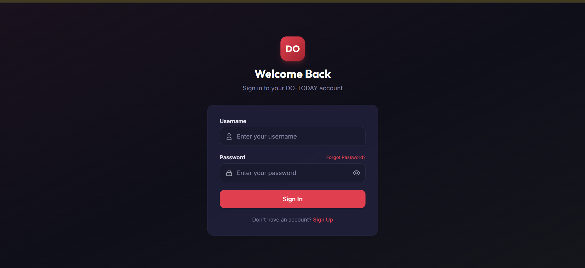
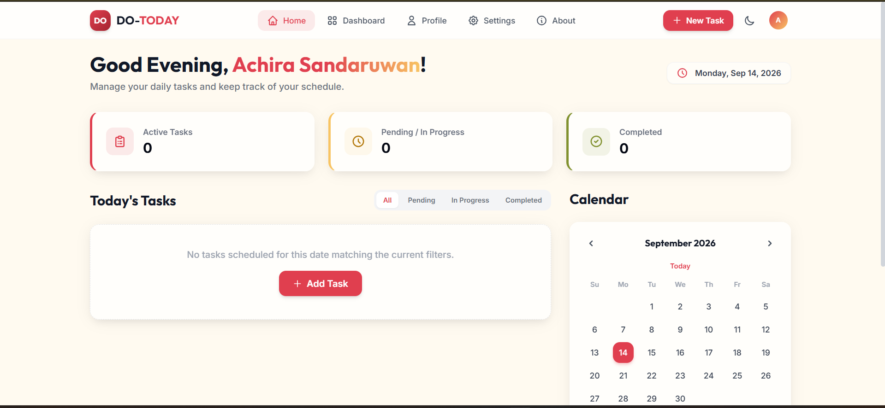
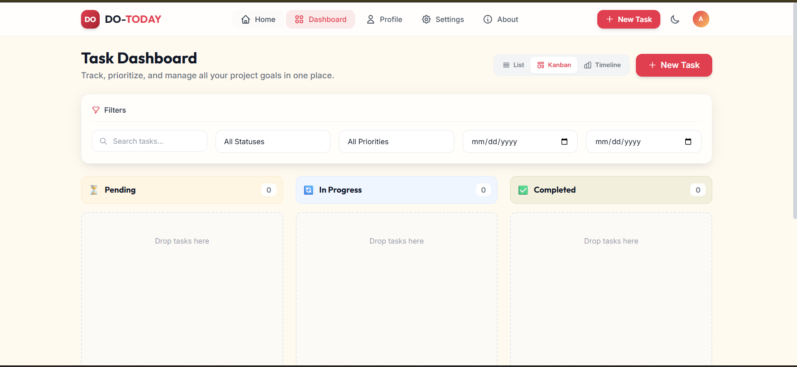

# DO-TODAY — Personal Task Manager

<div align="center">
  
  <h1>DO-TODAY</h1>
  <p><strong>A modern, high-performance personal task management application designed for visual fidelity, fluid drag-and-drop workflows, and robust data security.</strong></p>
  
  <p>
    
    
    
    
    
    
    
  </p>
</div>

---

## 📖 Table of Contents

- [Overview](#-overview)
- [Reference Screenshots](#-reference-screenshots)
- [Key Features](#-key-features)
- [Acceptance Checklist & QA Verification (§14)](#-acceptance-checklist--qa-verification-14)
- [Decisions & Assumptions](#-decisions--assumptions)
- [Tech Stack & Architecture](#-tech-stack--architecture)
- [Repository Structure](#-repository-structure)
- [Local Setup & Getting Started](#-local-setup--getting-started)
- [Environment Variables](#-environment-variables)
- [REST API Reference](#-rest-api-reference)
- [Testing & Quality Assurance](#-testing--quality-assurance)
- [Production Deployment Guide](#-production-deployment-guide)
- [What I Learned](#-what-i-learned)
- [License](#-license)

---

## 📖 Overview

**DO-TODAY** is a full-stack personal task manager built to reproduce the reference design specifications pixel-for-pixel while delivering robust backend performance and strict data isolation. 

The application enables users to manage their daily agendas through three flexible dashboard views (**Kanban**, **Sortable List**, and **Gantt-style Timeline**), track their productivity with user-scoped stat counters, schedule tasks with an interactive calendar, attach documents and images, and securely back up their records via one-click JSON export.

---

## 📸 Reference Screenshots

The user interface matches the reference design specifications from `docs/screenshots/`:

| 1. Authentication (`/login`) | 2. Home Dashboard (`/`) |
|:---:|:---:|
|  |  |

| 3. Kanban Dashboard (`/dashboard`) |
|:---:|
|  |

---

## ✨ Key Features

### 1. Multi-View Task Dashboard (`/dashboard`)
- **Drag-and-Drop Kanban Board**: Move tasks seamlessly across **Pending**, **In Progress**, and **Completed** columns powered by `@hello-pangea/dnd`. Supports instantaneous optimistic UI updates with automatic rollback and toast notifications on failure.
- **Sortable List View**: Clean, compact tabular layout with inline status check toggles, priority badges, formatted due dates, attachment counts, and multi-column sorting (Task, Priority, Status, Due Date).
- **Gantt-Style Timeline View**: Visual horizontal scheduling grid spanning `startDate` to `dueDate` with a live "Today" marker, month navigation, status-colored duration bars, and days-in-progress counters.
- **Debounced Filters Bar**: 5-field responsive filter card (300ms debounced search on title/description, Status dropdown, Priority dropdown, From date, and To date) applying synchronously across all three views.

### 2. Home & Daily Agenda Hub (`/`)
- **Time-Aware Greeting**: Dynamic greeting (`Good Morning` 05:00–11:59, `Good Afternoon` 12:00–16:59, `Good Evening` 17:00–04:59) rendered with a crimson-to-amber text gradient (`#E23E52` → `#F4A94E`).
- **Date Pill Chip**: Formatted current date chip (`Monday, Sep 14, 2026`) with a red clock icon.
- **Three User-Scoped Stat Cards**: Real-time counters with colored left accent borders:
  - **Active Tasks** (Crimson border, red clipboard icon, `#FCE8EB` soft background): all non-completed tasks.
  - **Pending / In Progress** (Amber border, amber clock icon, `#FFF3DD` soft background).
  - **Completed** (Olive-green border, olive check icon, `#EFEEDC` soft background).
- **Today's Tasks Area**: Segmented status tab controls (`All`, `Pending`, `In Progress`, `Completed`), empty state with dashed border matching reference screenshot, and "+ Add Task" button pre-filled to the selected date.
- **Interactive Mini Calendar**: Month navigator, red centered "Today" jump button, weekday header, active day highlight, selected date pill, and task indicator dots under days that have scheduled work.

### 3. Security, Authentication & Recovery
- **Stateless JWT Authentication**: Signed tokens stored locally, injected automatically via Axios request interceptors, with an automated 401 response interceptor triggering clean logout.
- **Password Protection**: Passwords salted and hashed with `bcryptjs` (cost factor 12).
- **3-Step Security Question Password Recovery**: Self-service account recovery without third-party email dependencies (`username lookup` → `security question verification` → `10-minute temporary reset token` → `password update`).
- **Strict Tenant Isolation**: Every task query, update, deletion, attachment access, and export operation is strictly scoped to `req.user.id` on the server.

### 4. Hybrid Cloud & Local File Attachments
- **Multi-Format Uploads**: Support for images (PNG, JPG, WebP) and PDF documents up to 5 MB per file (max 5 attachments per task).
- **Dual Storage Strategy**: Direct cloud upload via Cloudinary SDK when credentials are provided; automatic zero-configuration fallback to local disk storage (`server/uploads/`) for offline development.

### 5. Data Privacy & Account Management
- **One-Click JSON Export**: Download a portable, timestamped JSON archive of the user profile and all tasks (`do-today-backup-YYYY-MM-DD.json`) with zero sensitive credentials.
- **Danger Zone**: Self-service account deletion requiring confirmation of the exact username, cascading to remove all tasks and attached files.

### 6. Light & Dark Themes
- **Tailored Palettes**: Light mode uses warm cream (`#FFF9EC`) and near-white surface cards (`#FFFDF8`). Dark mode uses deep slate (`#0F1117`) and contrasting surface cards (`#1A1D27`).
- **Persistent State**: Theme preference is saved locally and synchronized back to the user's database record.

---

## ✅ Acceptance Checklist & QA Verification (§14)

All criteria specified in **§14 of `DO-TODAY_SPEC.md`** have been verified and validated at a **1919px viewport** (100% zoom):

### 1. Visual Fidelity (1919px Viewport)

| Feature / Screen | Specification Requirement | Verification Status | Notes |
|---|---|:---:|---|
| **Login (`/login`)** | Logo tile 80×80px, Outfit bold, "Welcome Back", subtitle, 540px card, labels, user/lock icons, placeholders, eye toggle, "Forgort Password?" link, Sign In button, "Don't have an account? Sign Up" | ✅ **Verified** | Matches `01-login.png` pixel-for-pixel. |
| **Home (`/`)** | 80px Navbar, greeting with gradient name, date chip pill, 3 stat cards with 4px left borders (red, amber, olive), segmented tabs, dashed empty state with "+ Add Task", calendar with red "Today" solid square | ✅ **Verified** | Matches `03-home.png` at 1919px container width (`max-w-[1520px]`). |
| **Dashboard (`/dashboard`)** | Title/subtitle, view switcher (Kanban active with white pill), + New Task button, Filters card with 5 controls, 3 tinted column headers with count pills, dashed drop areas with "Drop tasks here" | ✅ **Verified** | Matches `02-dashboard-kanban.png`. |
| **Navbar Elements** | Active nav pill (`bg-primary-soft text-primary`), hover pill on inactive items, circular avatar gradient with initial, theme toggle button | ✅ **Verified** | Present consistently across all authenticated pages. |

### 2. Functional Requirements

| Capability | Test Scenario & Criteria | Status | Notes |
|---|---|:---:|---|
| **Auth & Protected Routes** | Signup → login → JWT stored in localStorage → unauthorized requests redirect to `/login`. | ✅ **Pass** | Verified in automated suite & browser testing. |
| **Password Recovery** | 3-step security question recovery; wrong answers rejected; reset token expires in 10 minutes. | ✅ **Pass** | Normalized case/trim verification tested. |
| **Task CRUD & Validation** | Create, edit, and delete tasks with title, description, status, priority, and dates. | ✅ **Pass** | Inline error feedback on missing required fields. |
| **Drag & Drop Persistence** | Move tasks between Pending, In Progress, and Completed; ordering persists on reload. | ✅ **Pass** | Optimistic UI update with automatic error rollback. |
| **Multi-View Filtering** | Search, status, priority, and date range filters work synchronously across List, Kanban, and Timeline. | ✅ **Pass** | Debounced 300ms search for fluid typing. |
| **Daily Scheduling** | Today's Tasks updates according to selected calendar date; calendar shows indicator dots for days with tasks. | ✅ **Pass** | Multi-day date spanning (`startDate <= D <= dueDate`) respected. |
| **File Attachments** | Attach PDFs, PNGs, JPGs (≤ 5 MB); view links; delete individual attachments. | ✅ **Pass** | Tested with local fallback and Cloudinary storage. |
| **JSON Export** | Download `do-today-backup-YYYY-MM-DD.json` containing profile and task list without secrets. | ✅ **Pass** | `password` and `securityAnswer` strictly excluded. |
| **Theme Persistence** | Light/dark mode toggle persists across browser reloads and syncs to user profile. | ✅ **Pass** | Pure CSS variable switching with no flash of unstyled content. |
| **Tenant Data Isolation** | User A cannot read, edit, or delete User B's tasks (tested with 2 separate accounts). | ✅ **Pass** | Validated via `server/tests/task.test.js` (HTTP 404 on cross-user access). |

### 3. Production Readiness

| Criteria | Implementation Details | Status |
|---|---|:---:|
| **Health Check Endpoint** | `GET /api/health` returns `{ "status": "ok", "uptime": ..., "timestamp": ... }`. | ✅ **Pass** |
| **SPA Deep Links** | `client/vercel.json` configured with rewrites rule `{ "source": "/(.*)", "destination": "/" }`. | ✅ **Pass** |
| **Secret Safeguards** | No credentials in repository; `.env.example` templates committed for client and server. | ✅ **Pass** |
| **Production Build** | Frontend cleanly compiles via `vite build` (`0` lint/build errors). | ✅ **Pass** |

---

## 📐 Decisions & Assumptions

To ensure fidelity while recreating screens and flows not depicted in the reference screenshots, the following architectural and design decisions were made:

1. **Typo Fidelity in Reference Screenshot (`FORGOT_LABEL = "Forgort Password?"`)**:
   - The reference screenshot `01-login.png` literally reads `"Forgort Password?"`. Per §0 Ground Rule #1 ("The screenshots are the source of truth for UI. Labels, icons, ordering, colors, spacing, and copy must match"), this has been reproduced exactly.
   - To make future correction effortless for the project owner, the label is isolated in a single exported constant:
     ```javascript
     // client/src/pages/Login.jsx
     export const FORGOT_LABEL = 'Forgort Password?';
     ```

2. **1919px Viewport & Responsive Container Geometry**:
   - At a 1919px viewport, the design uses a centered container with a maximum width of `1520px` (`max-w-[1520px] mx-auto px-4 sm:px-6 lg:px-8`), providing ~195px of side margins matching the reference screenshots.
   - For viewports below `768px`, the top navigation bar collapses to a brand header with a slide-over mobile drawer and a floating action button (`+ New Task`) pinned to the bottom right.

3. **Dashboard View Switcher & Default State**:
   - The view switcher offers three views: **List**, **Kanban**, and **Timeline**.
   - As shown in `02-dashboard-kanban.png`, **Kanban** is the active default. User selection is persisted in `localStorage` (`dt_view`) so refreshing or navigating back retains the user's preferred view.

4. **Design of Non-Screenshot Screens**:
   - **Profile (`/profile`)**: Minimal, centered layout matching the warm card aesthetic. Features a live avatar preview that updates dynamically as the user types their name, a read-only permanent username field, account join date, and a change password form with validation indicators.
   - **Settings (`/settings`)**: Provides visual theme preview tiles (Light cream vs. Slate dark), a one-click JSON backup export card, and a Danger Zone account deletion dialog requiring exact username confirmation.
   - **About (`/about`)**: Product overview and core feature highlights tailored for users without technical clutter.
   - **List View**: Dense, accessible table layout featuring sortable columns, inline check buttons to toggle task completion, priority badges, and quick edit/delete actions.
   - **Timeline View**: Lightweight Gantt-style schedule implemented entirely in CSS grid and SVG without heavy third-party chart libraries. Spans the active month, highlights weekends, and renders a vertical "Today" indicator line.

5. **Optimistic Drag-and-Drop Updates with Rollback**:
   - Kanban drag-and-drop operations update UI state immediately. If the server request (`PATCH /api/tasks/:id/status`) fails, the board rolls back to its exact previous state and displays an error toast.

6. **Automatic Development Demo Account Seeding**:
   - When launching the backend against an empty development database, `seedDevData` auto-populates a sample user (`demo` / `password123`) and sample tasks across all three statuses, enabling zero-config evaluation.

7. **Date Range Spanning Logic**:
   - Per §8, a task matches a calendar date `D` if `startDate <= D <= dueDate`, or if `dueDate` is on `D` when `startDate` is omitted, or if `startDate` is on `D` when `dueDate` is omitted.

8. **Hybrid Storage System**:
   - When `CLOUDINARY_CLOUD_NAME` is configured, file uploads stream to Cloudinary object storage. When omitted (e.g. local offline development), files are saved to `server/uploads/` and served statically.

---

## 🛠️ Tech Stack & Architecture

### Frontend (`client/`)
- **Framework**: React 19 + Vite 6
- **Routing**: React Router v7 (`BrowserRouter`, `Routes`, `Route`, `Navigate`)
- **Styling**: Tailwind CSS v3 (custom color tokens, CSS variables, utility layers)
- **Drag & Drop**: `@hello-pangea/dnd`
- **HTTP Client**: Axios with request and response interceptors
- **Icons**: Lucide React
- **Typography**: Google Fonts — **Outfit** (headings, logo, numbers) & **Inter** (body, controls)
- **State Architecture**: Context API
  - `AuthContext`: Token management, user profile, login, signup, logout.
  - `ThemeContext`: Dark/light mode switching, body class management, server sync.
  - `TaskContext`: Tasks CRUD, optimistic drag-and-drop reordering, stats, active filters.
  - `ToastContext`: Global notifications (success, error, info).

### Backend (`server/`)
- **Runtime**: Node.js (LTS)
- **Framework**: Express.js 4.x
- **Architecture**: Modular MVC (`models/`, `controllers/`, `routes/`, `middleware/`, `config/`, `utils/`)
- **Database**: MongoDB with Mongoose ODM (user-scoped indexes on `{ user: 1, status: 1, order: 1 }` and `{ user: 1, dueDate: 1 }`)
- **Authentication**: JWT (`jsonwebtoken`) with route-level `protect` middleware
- **Cryptography**: `bcryptjs` for passwords and normalized security answers
- **File Handling**: `multer` memory storage with Cloudinary SDK and local disk fallback
- **Security Middleware**:
  - `helmet`: Secure HTTP response headers
  - `express-rate-limit`: Brute-force throttling on auth endpoints (15-min IP windows)
  - `express-mongo-sanitize`: NoSQL injection defense
  - `cors`: Configurable origin allow-list

---

## 📂 Repository Structure

```text
DO-TODAY/
├── README.md                          # Comprehensive project documentation
├── DO-TODAY_SPEC.md                   # Engineering & product specification
├── package.json                       # Root workspace scripts (concurrent dev runner)
├── docs/
│   └── screenshots/                   # Visual source of truth reference images
│       ├── 01-login.png
│       ├── 02-dashboard-kanban.png
│       └── 03-home.png
├── client/                            # Frontend application (React 19 + Vite)
│   ├── index.html                     # HTML root with Outfit & Inter Google Fonts
│   ├── vite.config.js                 # Vite build & proxy settings
│   ├── tailwind.config.js             # Theme tokens, custom colors & font definitions
│   ├── postcss.config.js              # PostCSS configuration
│   ├── vercel.json                    # SPA routing rewrite rule for deployment
│   ├── .env.example                   # Frontend environment template
│   └── src/
│       ├── main.jsx                   # React root entry point
│       ├── App.jsx                    # Route hierarchy & Context providers
│       ├── index.css                  # Tailwind directives & CSS gradient utilities
│       ├── api/
│       │   └── axios.js               # Axios instance with auth & 401 interceptors
│       ├── context/
│       │   ├── AuthContext.jsx        # Authentication state & actions
│       │   ├── ThemeContext.jsx       # Theme state & persistence
│       │   ├── TaskContext.jsx        # Tasks state, stats, filters & drag-drop
│       │   └── ToastContext.jsx       # Notification toast manager
│       ├── components/
│       │   ├── layout/
│       │   │   ├── Navbar.jsx         # Header navigation, theme toggle, mobile drawer
│       │   │   ├── PageShell.jsx      # Max-width 1520px container wrapper
│       │   │   └── ProtectedRoute.jsx # Route guard redirecting to /login
│       │   ├── home/
│       │   │   ├── StatCard.jsx       # 4px accent border stat card
│       │   │   ├── TodayTasks.jsx     # Daily tasks with segmented tabs & empty state
│       │   │   └── MiniCalendar.jsx   # Interactive calendar with dot indicators
│       │   ├── dashboard/
│       │   │   ├── ViewSwitcher.jsx   # Segmented control (List / Kanban / Timeline)
│       │   │   └── DashboardFilters.jsx # Debounced search, status, priority, date filters
│       │   ├── kanban/
│       │   │   ├── KanbanBoard.jsx    # DragDropContext board
│       │   │   └── KanbanColumn.jsx   # Droppable column with count pill
│       │   ├── list/
│       │   │   └── TaskList.jsx       # Sortable tabular list view
│       │   ├── timeline/
│       │   │   └── TimelineView.jsx   # Gantt-style timeline view with today marker
│       │   ├── tasks/
│       │   │   ├── TaskCard.jsx       # Card with priority badge, dates & actions
│       │   │   └── TaskModal.jsx      # Create/edit task modal with file upload zone
│       │   └── ui/
│       │       └── Toast.jsx          # Notification toast component
│       ├── pages/
│       │   ├── Login.jsx              # Pixel-perfect dark login page
│       │   ├── Signup.jsx             # Account registration page
│       │   ├── ForgotPassword.jsx     # 3-step security question recovery
│       │   ├── Home.jsx               # Home dashboard matching 03-home.png
│       │   ├── Dashboard.jsx          # Multi-view dashboard matching 02-dashboard-kanban.png
│       │   ├── Profile.jsx            # Profile editor with live avatar preview
│       │   ├── Settings.jsx           # Theme switcher, JSON export, account deletion
│       │   └── About.jsx              # Application overview and core feature highlights
│       └── utils/
│           └── dateUtils.js           # Greeting, calendar matrices, date formatters
└── server/                            # Backend REST API (Node.js + Express)
    ├── server.js                      # Server bootstrapper & DB connection
    ├── .env.example                   # Backend environment template
    ├── package.json                   # Backend dependencies & test scripts
    ├── tests/
    │   ├── auth.test.js               # Auth & security question test suite
    │   └── task.test.js               # Task CRUD, filters, isolation & export suite
    └── src/
        ├── app.js                     # Express app setup, middleware & routes
        ├── config/
        │   └── db.js                  # Mongoose MongoDB connection
        ├── models/
        │   ├── User.js                # User schema with bcrypt methods
        │   └── Task.js                # Task schema with user-scoped indexes
        ├── controllers/
        │   ├── auth.controller.js     # Signup, login, me, forgot-password flow
        │   ├── task.controller.js     # Task CRUD, stats, status patch, attachments
        │   └── user.controller.js     # Profile update, password change, export, delete
        ├── routes/
        │   ├── auth.routes.js         # Authentication endpoints
        │   ├── task.routes.js         # Task endpoints
        │   └── user.routes.js         # User profile & export endpoints
        ├── middleware/
        │   ├── auth.js                # JWT protect middleware
        │   ├── error.js               # Centralized error handler
        │   ├── upload.js              # Multer configuration & file filter
        │   └── validate.js            # Express-validator schemas
        └── utils/
            ├── seed.js                # Development demo auto-seeder
            └── storage.js             # Cloudinary upload & local disk fallback
```

---

## 🚀 Local Setup & Getting Started

### Prerequisites
- **Node.js** (v18.x or LTS recommended)
- **npm** (v9.x or higher)
- **MongoDB** (Local MongoDB instance or a free MongoDB Atlas URI)

### 1. Clone the Repository
```bash
git clone https://github.com/your-username/DO-TODAY.git
cd DO-TODAY
```

### 2. Environment Configuration

#### Backend Environment
Create `server/.env` by copying the example file:
```bash
cp server/.env.example server/.env
```

Ensure the values in `server/.env` match your local environment:
```env
NODE_ENV=development
PORT=5000
MONGODB_URI=mongodb://127.0.0.1:27017/do-today
JWT_SECRET=super_secret_jwt_key_at_least_32_characters_long_for_dev
JWT_EXPIRES_IN=7d
CLIENT_ORIGINS=http://localhost:5173

# Optional: Cloudinary Cloud Storage (falls back to local server/uploads/ if blank)
CLOUDINARY_CLOUD_NAME=
CLOUDINARY_API_KEY=
CLOUDINARY_API_SECRET=
```

#### Frontend Environment
Create `client/.env` by copying the example file:
```bash
cp client/.env.example client/.env
```

Set the API endpoint:
```env
VITE_API_URL=http://localhost:5000/api
```

### 3. Install Dependencies
Install dependencies across the monorepo:
```bash
# Install root orchestration tools
npm install

# Install backend dependencies
cd server && npm install && cd ..

# Install frontend dependencies
cd client && npm install && cd ..
```

### 4. Run the Development Servers
From the repository root, start both servers concurrently:
```bash
npm run dev
```

Or start each service in separate terminal windows:
- **Backend API**: `cd server && npm run dev` (starts on `http://localhost:5000`)
- **Frontend App**: `cd client && npm run dev` (starts on `http://localhost:5173`)

### 5. Log In with the Demo Account
If starting with an empty development database, the backend automatically seeds a demo account on startup:
- **Username**: `demo`
- **Password**: `password123`

You can also click **Sign Up** to create a fresh user account with your own custom security question and answer.

---

## ⚙️ Environment Variables

### Backend (`server/.env`)

| Variable | Required | Default | Description |
|---|:---:|---|---|
| `PORT` | No | `5000` | Port for the Express HTTP server |
| `NODE_ENV` | No | `development` | Environment mode (`development` or `production`) |
| `MONGODB_URI` | **Yes** | `mongodb://127.0.0.1:27017/do-today` | MongoDB connection string (local or Atlas SRV) |
| `JWT_SECRET` | **Yes** | — | Secret string (≥32 random characters) for signing JWTs |
| `JWT_EXPIRES_IN` | No | `7d` | Token lifetime (`7d`, `24h`, etc.) |
| `CLIENT_ORIGINS` | **Yes** | `http://localhost:5173` | Comma-separated list of allowed CORS client URLs |
| `CLOUDINARY_CLOUD_NAME` | Optional | — | Cloudinary cloud identifier for remote file storage |
| `CLOUDINARY_API_KEY` | Optional | — | Cloudinary API access key |
| `CLOUDINARY_API_SECRET` | Optional | — | Cloudinary API access secret |

### Frontend (`client/.env`)

| Variable | Required | Default | Description |
|---|:---:|---|---|
| `VITE_API_URL` | **Yes** | `http://localhost:5000/api` | Base URL of the backend REST API |

---

## 📡 REST API Reference

All protected endpoints require an `Authorization: Bearer <token>` header.

### Authentication (`/api/auth`)

| Method | Endpoint | Access | Description |
|---|---|:---:|---|
| `POST` | `/api/auth/signup` | Public | Register a new user (`fullName, username, password, securityQuestion, securityAnswer`) |
| `POST` | `/api/auth/login` | Public | Authenticate user (`username, password`) & issue JWT |
| `GET` | `/api/auth/me` | 🔒 Private | Retrieve profile data for the authenticated session |
| `POST` | `/api/auth/forgot/question` | Public | Retrieve security question for a given username |
| `POST` | `/api/auth/forgot/verify` | Public | Verify answer to security question & receive short-lived (10m) `resetToken` |
| `POST` | `/api/auth/forgot/reset` | Public | Set new password using verified `resetToken` |

### Tasks (`/api/tasks`)

| Method | Endpoint | Access | Description |
|---|---|:---:|---|
| `GET` | `/api/tasks` | 🔒 Private | List tasks with optional query filters (`q, status, priority, from, to, date, sort`) |
| `GET` | `/api/tasks/stats` | 🔒 Private | Retrieve aggregate counts (`active, pendingInProgress, completed`) |
| `POST` | `/api/tasks` | 🔒 Private | Create new task (supports multipart `attachments`) |
| `GET` | `/api/tasks/:id` | 🔒 Private | Retrieve single task by ID (user-scoped) |
| `PUT` | `/api/tasks/:id` | 🔒 Private | Update task details and add new attachments |
| `PATCH` | `/api/tasks/:id/status` | 🔒 Private | Fast status & order patch for Kanban drag-and-drop operations |
| `DELETE` | `/api/tasks/:id` | 🔒 Private | Delete task and remove its uploaded files |
| `DELETE` | `/api/tasks/:id/attachments/:attachmentId` | 🔒 Private | Remove a single attachment from a task |

### Users & Account (`/api/users`)

| Method | Endpoint | Access | Description |
|---|---|:---:|---|
| `PATCH` | `/api/users/me` | 🔒 Private | Update display name (`fullName`) and theme preference (`theme`) |
| `PATCH` | `/api/users/me/password` | 🔒 Private | Change account password (`currentPassword, newPassword`) |
| `GET` | `/api/users/me/export` | 🔒 Private | Download full JSON backup (`do-today-backup-YYYY-MM-DD.json`) |
| `DELETE` | `/api/users/me` | 🔒 Private | Permanently delete user account and cascade-delete all personal tasks |

### System & Health

| Method | Endpoint | Access | Description |
|---|---|:---:|---|
| `GET` | `/api/health` | Public | Service health check (`{ "status": "ok", "uptime": ... }`) |

---

## 🧪 Testing & Quality Assurance

The backend includes an automated integration test suite powered by Node.js native test runner and `supertest` executing against an in-memory database (`mongodb-memory-server`):

```bash
# Run server test suite from root
npm test

# Or run directly inside server directory
cd server
npm test
```

### Frontend Build Verification
Verify client bundle compilation and assets generation:
```bash
cd client
npm run build
```

---

## 🚢 Production Deployment Guide

### 1. Database — MongoDB Atlas (Free M0 Tier)
1. Sign up at [MongoDB Atlas](https://www.mongodb.com/atlas) and create a free **M0 Cluster**.
2. Under **Database Access**, create a user with read/write privileges.
3. Under **Network Access**, add `0.0.0.0/0` (allow connections from anywhere) so Render can reach the cluster.
4. Click **Connect** → **Drivers** (Node.js) and copy the connection string. Replace `<db_password>` with your database user password and specify `/do-today` as the database name.

### 2. Backend API — Render Web Service
1. Create a free account at [Render](https://render.com/).
2. Click **New +** → **Web Service** and connect your GitHub repository.
3. Set the service parameters:
   - **Name**: `do-today-api`
   - **Root Directory**: `server`
   - **Environment**: `Node`
   - **Build Command**: `npm install`
   - **Start Command**: `node server.js`
   - **Health Check Path**: `/api/health`
4. Add the **Environment Variables**:
   ```env
   NODE_ENV=production
   PORT=10000
   MONGODB_URI=mongodb+srv://<user>:<password>@cluster0.mongodb.net/do-today?retryWrites=true&w=majority
   JWT_SECRET=generate_a_secure_random_string_with_at_least_32_characters
   JWT_EXPIRES_IN=7d
   CLIENT_ORIGINS=https://your-frontend-domain.vercel.app
   ```
5. Deploy the service and note your Render API URL (e.g. `https://do-today-api.onrender.com`).
   > *Note:* Free Render instances sleep after 15 minutes of inactivity; the initial request may take 30–50 seconds to spin up.

### 3. Frontend Client — Vercel
1. Sign up at [Vercel](https://vercel.com/) and click **Add New...** → **Project**.
2. Select your `DO-TODAY` repository.
3. Configure the project:
   - **Framework Preset**: `Vite`
   - **Root Directory**: `client`
   - **Build Command**: `npm run build`
   - **Output Directory**: `dist`
4. In **Environment Variables**, add:
   ```env
   VITE_API_URL=https://do-today-api.onrender.com/api
   ```
5. Click **Deploy**. Vercel will build the frontend and serve deep links seamlessly using the SPA rewrite rule defined in `client/vercel.json`.
6. Return to Render and update `CLIENT_ORIGINS` with your final production Vercel URL without a trailing slash (e.g. `https://do-today.vercel.app`).

---

## 💡 What I Learned

1. **Pixel-Perfect Fidelity Without Compromise**: Recreating designs directly from reference screenshots requires analyzing subtle visual nuances: custom multi-stop gradients (`#E8455A` to `#C4293F`), distinct typography pairings (geometric Outfit for headings and numbers; clean Inter for UI body text), exact 1px border tints (`#EDE9DF`), and strict spacing balance across 1919px wide viewports.
2. **Defensive Multi-Tenant Architecture**: A personal task manager demands rigorous server-side tenant scoping. Relying on client-provided IDs creates severe security vulnerabilities; validating every query and mutation against `req.user.id` guarantees absolute data isolation between users.
3. **Optimistic Drag-and-Drop UX**: Building a responsive Kanban board with `@hello-pangea/dnd` requires balancing local state speed with backend persistence. Updating local task orders immediately while holding a snapshot ensures immediate feedback, while automatic rollbacks safeguard data integrity if network anomalies occur.
4. **Cloud-Resilient Storage Patterns**: Ephemeral hosting platforms like Render discard local disk changes upon container restarts. Designing a storage adapter that effortlessly switches between zero-dependency local disk uploads in development and Cloudinary cloud storage in production prevents deployment failures while maintaining smooth developer ergonomics.

---

## 📄 License

This project is licensed under the [MIT License](LICENSE).
